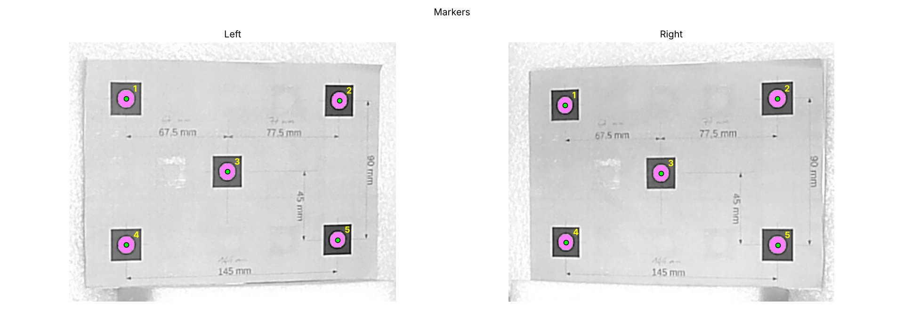

# LowCost3Dpositioning

Low-cost stereo-vision triangulation system for ultrasonic probe positioning.

Supplementary code for

> S. Cygan, M. Urban, A. Czyżyk, J. Żmigrodzki, *Low-cost 3D vision-based
> triangulation system for ultrasonic probe positioning*,
> Pol J Med Phys Eng 2024;30(4):249–257,
> [doi:10.2478/pjmpe-2024-0029](https://doi.org/10.2478/pjmpe-2024-0029).

The repository contains a Python implementation (`lowcost3d/`) and the
original MATLAB scripts published with the paper (`matlab/`). The Python
version follows the same method: you click near each marker, the marker is
segmented by seeded region growing, the cameras are calibrated by DLT from
the calibration frame, and the probe markers are triangulated. It also fixes
the problems listed below. It needs no MATLAB toolboxes.

## Installation

```bash
git clone https://github.com/szcygan/LowCost3Dpositioning.git
cd LowCost3Dpositioning
pip install -e .            # or: pip install -e ".[test]" to run the tests
```

Requires Python ≥ 3.9 with numpy, scipy, matplotlib, pillow, pandas and openpyxl.

## Usage

### 1. Calibrate the cameras

```bash
lowcost3d calibrate --left data/calibrationLeft.jpg --right data/calibrationRight.jpg \
                    --markers data/markersFrame.xlsx --save-seeds my_calib
```

A window opens for each camera. Click every marker of the calibration frame in
the order given by `data/markingOrder.png`, which is shown next to the image:

| action | effect |
|---|---|
| left click | add a marker seed (numbered on screen) |
| right click / Backspace | undo the last seed |
| Enter | finish (only when all markers are clicked) |
| Esc | cancel |
| toolbar zoom / pan | zoom in for precise clicks; clicks are ignored while active |

The clicks only need to land *inside* each marker: the position used is the
centroid of the segmented marker. `--save-seeds PREFIX` stores the clicks so
the calibration can be repeated or re-tuned later without clicking again:
`--seeds-left PREFIX_left.csv --seeds-right PREFIX_right.csv`. If `--left` or
`--right` is omitted, a file dialog opens.

The calibration is saved to `calibration.json`. For each camera it holds the
projection matrix, the reprojection errors, the leave-one-out errors, the
estimated camera centre and the focal length.

### 2. Locate the probe markers (or a validation board)

```bash
lowcost3d locate --calibration calibration.json \
                 --left data/probeLeft.jpg --right data/probeRight.jpg
```

Click the probe-holder markers in the left image, then the same markers **in
the same order** in the right image. The command prints and saves to
`triangulation.json`:

* the 3-D marker positions in the frame coordinate system (mm), with
  per-marker reprojection errors,
* all pairwise marker distances,
* the fitted marker plane `ax + by + cz + d = 0`, with its normal pointing
  towards the cameras, and the coplanarity errors,
* with `--model nominal.csv` (the nominal marker coordinates, in the same
  order), the rigid transform from the model to the measurement and the
  residual of every marker. This gives the full 6-DoF pose of the holder, or
  the accuracy on a validation board:

```bash
lowcost3d locate --left data/validationLeft.jpg --right data/validationRight.jpg \
                 --seeds-left data/seeds/validation_left.csv \
                 --seeds-right data/seeds/validation_right.csv \
                 --model data/validation_board.csv
```

### 3. (Optional) tune the segmentation parameters

```bash
lowcost3d tune --left data/calibrationLeft.jpg --right data/calibrationRight.jpg \
               --markers data/markersFrame.xlsx \
               --seeds-left my_calib_left.csv --seeds-right my_calib_right.csv \
               --radii 1:8 --dists 0.01:0.2:0.01 --plot tuning.png
```

Common options are `--max-dist` (region-growing limit, default 0.04 for
calibration and 0.10 for localisation, as in the paper), `--disk-radius`
(closing radius, default 6 px), `--no-refine` (plain DLT and linear
triangulation, as in MATLAB), `--legacy-mean` and `--no-fill-holes` (both
reproduce the original segmentation), `--plot FILE` and `--no-show`. Run
`lowcost3d <command> -h` for the full list.

### From Python

```python
from lowcost3d import io, calibrate, locate

cal = calibrate(io.load_gray("calibrationLeft.jpg"), io.load_gray("calibrationRight.jpg"),
                io.load_points("markersFrame.xlsx"), seeds_left, seeds_right)
res = locate(cal, io.load_gray("probeLeft.jpg"), io.load_gray("probeRight.jpg"),
             probe_seeds_left, probe_seeds_right)
res["points_mm"], res["plane"]
```

## Results on the example images

The seed files in `data/seeds/` reproduce the following without any clicking.
The test suite checks them (`pytest`).

| quantity | value |
|---|---|
| calibration, mean reprojection error | 0.42 px (max 0.71 px) |
| validation board, horizontal distances (nominal 145 mm) | 144.8 / 145.4 mm |
| validation board, vertical distances (nominal 90 mm) | 90.7 / 90.7 mm |
| validation board, rigid-fit RMS residual (5 markers) | **0.54 mm** |
| validation board, coplanarity RMS | 0.18 mm |



## Differences from the MATLAB scripts

Issues found in the original code, and how the Python version handles them:

1. **The triangulation used the raw clicks, not the marker centroids**
   (`probePositionEstimator.m`, lines 78–92). The markers were segmented and
   their centroids (`sm1`, `sm2`) computed and displayed, but `triangulate`
   received `coord_LC = [x1, y1]` and `coord_RC = [x2, y2]`, the rounded
   mouse clicks. The result therefore depended on where the user clicked. On
   the validation board, simulated clicks spread up to 6 px from the marker
   centres (30 trials) gave an RMS error of **1.9 ± 0.5 mm (max 3.1 mm)**.
   The centroids give **0.54 mm** wherever the click lands. In MATLAB, the fix
   is `coord_LC = sm1; coord_RC = sm2;`.
2. **File paths.** `setupCalibrator.m` ignores the folder returned by
   `uigetfile`, so it only works when the images are in the current folder.
   `probePositionEstimator.m` reads the right image from the folder of the
   *left* one. The Python version uses explicit paths or a file dialog.
3. **Left/right naming.** `im1` holds the *right* image while the comments
   and figure titles call it left, and `camMatrix1` belongs to the right
   camera. The results are correct only because the two swaps cancel out.
   Python names everything explicitly `left`/`right`.
4. **No input checks.** Clicking a different number of markers in the two
   views, or a number that does not match the marker table, ran on silently
   or failed with an indexing error. A wrong click order went unnoticed.
   Python requires the exact count. It warns when a reprojection error exceeds
   3 px, which is what a swapped pair of markers produces: tens of pixels,
   against well under 1 px for correct input.
5. **Region growing** (`regiongrowing.m`, after D. Kroon):
   * the running mean was updated with weight `n + 1` instead of `n`
     (`--legacy-mean` reproduces the old behaviour; `tests/` checks it against
     a line-by-line port);
   * every step scanned the whole neighbour list, so growing an N-pixel
     region cost O(N²). The frontier is now kept in per-grey-level buckets,
     which makes it O(N);
   * there was no guard against a region leaking into the background. Growth
     now stops with an error at `--max-area` pixels;
   * holes left by specular highlights are filled (`--no-fill-holes`
     disables this).
6. **Parameter tuning.** `parameterTuning.m` was not standalone: it relied
   on variables left in the workspace by `setupCalibrator.m`. It also picked
   the setting with the lowest *in-sample* reprojection error, which does not
   track accuracy. With 8 points and 11 unknowns the in-sample error is small
   by construction. On the example data it favoured the smallest threshold,
   while validation accuracy favoured the largest. `lowcost3d tune` also
   reports the leave-one-out error and recommends the setting that minimises
   it. On the example data the differences are small anyway: over the whole
   grid the validation RMS stays between 0.46 and 0.57 mm, and the disk
   radius has no measurable effect, so the defaults are adequate.
7. **Calibration.** The DLT now uses Hartley normalisation and is refined by
   minimising the geometric reprojection error. Coplanar or too few
   calibration points are rejected. The projection matrix is decomposed into
   focal length, principal point, skew and camera centre for a sanity check.
   On the example data the gain is small (0.44 → 0.42 px), but the estimate
   no longer depends on the conditioning of raw pixel and millimetre values.
8. **Outputs.** `save('calibrationResults2.mat')` saved the whole workspace,
   images included. Results are now compact, readable JSON. The plane normal,
   whose sign is arbitrary in an SVD fit, is oriented towards the cameras so
   repeated measurements are comparable. Measurement images whose size
   differs from the calibration images are rejected.
9. **Dependencies.** The MATLAB code needed the Image Processing and Computer
   Vision toolboxes, and calls changed between releases
   (`estimateCameraMatrix` → `estimateCameraProjection`).

Conventions: pixel coordinates are 0-based (MATLAB uses 1-based), so the
projection matrices are not interchangeable with MATLAB ones without a
one-pixel shift. Grayscale conversion uses the MATLAB `rgb2gray` weights.

## Known limitations

* **Lens distortion is not modelled** (pinhole/DLT model, as in the paper).
  Calibrating the camera intrinsics with a checkerboard and undistorting the
  centroids before triangulation would remove this error source.
* **The calibration geometry is weak in the X direction.** Only markers 1
  and 2 lie at X ≈ 246 mm. Their leave-one-out errors reach 8–12 px (marker 1
  in both cameras, marker 2 in the left one), against 0.5–2.4 px for the
  others, so small segmentation errors on these two markers
  strongly affect the calibration. Adding markers spread further over the
  measurement volume would make the calibration more robust.
* The centroid of a sphere's silhouette is not exactly the projection of the
  sphere's centre under perspective. The bias is sub-pixel for the marker
  sizes used here.

## License and citation

Everything in this repository (code, data, drawings) is released under the
[Creative Commons Attribution 4.0 International](https://creativecommons.org/licenses/by/4.0/)
license (CC BY 4.0, see [LICENSE](LICENSE)). You may use, modify and
redistribute it for any purpose, including commercially.

**Required attribution:** under Section 3(a) of the license, the licensors
request that attribution be given by citing the article:

> S. Cygan, M. Urban, A. Czyżyk, J. Żmigrodzki, *Low-cost 3D vision-based
> triangulation system for ultrasonic probe positioning*,
> Pol J Med Phys Eng 2024;30(4):249–257, doi:10.2478/pjmpe-2024-0029.

```bibtex
@article{Cygan2024LowCost3D,
  author  = {Cygan, Szymon and Urban, Mateusz and Czy{\.z}yk, Anna and {\.Z}migrodzki, Jakub},
  title   = {Low-cost {3D} vision-based triangulation system for ultrasonic probe positioning},
  journal = {Polish Journal of Medical Physics and Engineering},
  year    = {2024},
  volume  = {30},
  number  = {4},
  pages   = {249--257},
  doi     = {10.2478/pjmpe-2024-0029}
}
```

The citation metadata is also in [CITATION.cff](CITATION.cff), so GitHub's
"Cite this repository" button gives the same reference.

## Repository layout

```
lowcost3d/      Python package (segmentation, calibration, geometry, pipeline, CLI)
tests/          pytest suite: synthetic cameras + the example images
data/           example images, marker coordinates, seed files, validation board model
hardware/       calibration frame (SVG, laser cutting) and marker holder (STL)
matlab/         original MATLAB scripts as published with the paper
docs/           figures used in this README
```
